# 🛒 Awesome-E-Commerce-Storefront-Builder

  

  
  
  
  
  
  

---

## 🌟 Top E-Commerce Storefront Builder Ecosystem

> ⚡ **Curated List of SaaS Platforms & Open-Source GitHub Projects for Online Storefronts, Headless Commerce, and Self-Hosted Shopping Carts.**  
> 🏷️ *Keywords: ecommerce, storefront, headless commerce, online store, shopify alternatives, shopping cart, self-hosted commerce, ecommerce platform, medusa, saleor, woocommerce.*  
> 📅 **Last updated: March 2026**

This repository tracks notable **SaaS platforms** and **open-source projects** for **E-Commerce Storefront Builders**. These tools empower merchants, brands, and developers to design, launch, and scale online shops—covering everything from visual drag-and-drop website editors to composable, headless commerce frameworks where you own 100% of your code, database, and checkout flow.

Category examples include industry giants like **Shopify**, **BigCommerce**, **Wix eCommerce**, **Squarespace Commerce**, and **Adobe Commerce**, alongside high-growth open-source engines like **Medusa**, **Saleor**, **Vendure**, **WooCommerce**, **Bagisto**, and **PrestaShop**.

💡 **Open-Source & Self-Hosted Focus**: This list highlights active projects for self-hosted e-commerce, open-source storefront frameworks, and community-driven commerce stacks—ideal for merchants seeking to escape rising platform transaction fees, revenue-tier penalties, and checkout lock-in. **Medusa** leads modern TypeScript stacks with 37k+ stars and 0% GMV fee on cloud, **WooCommerce** powers content-rich stores with zero platform fees, and **Vendure** provides an enterprise GraphQL-first architecture.

---

## 📑 Table of Contents
- [📊 Sector Overview & Market Dynamics](#-sector-overview--market-dynamics)
- [🛍️ SaaS / Hosted Platforms](#️-saas--hosted-platforms)
- [🔓 Open-Source GitHub Projects](#-open-source-github-projects)
- [🛠️ How to Contribute](#️-how-to-contribute)
- [💖 Support & Sponsorship](#-support--sponsorship)
- [📈 Star History](#-star-history)
- [⚠️ Disclaimer](#️-disclaimer)

---

## 📊 Sector Overview & Market Dynamics

The global e-commerce software and storefront builder market is estimated at **$9.4B–$12.4B** (scaling toward **$30B+** at an ~11–15% CAGR). The sector is **moderately fragmented**: while a handful of dominant leaders (such as Shopify, WooCommerce, Adobe, and Squarespace) control the lion's share of global transaction volumes, no single player has achieved a winner-take-all monopoly due to diverging merchant needs across drag-and-drop SMB builders, composable/headless enterprise architectures, and localized regional payment ecosystems.

---

## 🛍️ SaaS / Hosted Platforms

| Product | Company Size (Market Cap / Valuation / Revenue) | Description | Pricing (Starting) | Free Tier / Trial Limits |
|---------|------------------------------------------------|-------------|-------------------|--------------------------|
| **[Shopify](https://www.shopify.com/)** | **~$185B–$210B Market Cap** ($11.56B FY2025 Revenue) | Leading hosted commerce platform with the broadest app ecosystem. Plans chosen by features (not revenue caps). **Third-party payment gateways add 0.6%–2% on top of gateway fees**. Checkout customization reserved for Plus. | Starter: **$5/month**; Basic: **$29/month** (annual) / **$39/month** (monthly); Grow: **$79/month**; Advanced: **$299/month**; Plus: starting at **$2,300/month** | **3-day free trial** (often includes promotional $1/month for the first month); no permanent free tier. Full feature testing during trial. |
| **[Adobe Commerce](https://business.adobe.com/)** | **~$94B Market Cap** ($23.77B FY2025 Revenue) | Enterprise commerce platform (Magento core with managed cloud). Multi-store, B2B modules, and complex ERP integrations. | Starts at **$1,833/month** (billed annually from **$22,000/year** for on-prem license, and from **$40,000/year** for Cloud PaaS); scales with GMV tier. | **30-day sandbox evaluation trial** upon sales request approval; Magento Open Source edition is free to self-host indefinitely. |
| **[Squarespace Commerce](https://www.squarespace.com/)** | **$7.2B Take-Private Valuation** (~$1.1B+ Revenue) | Polished content-and-commerce presentation for creators and modest catalogs. Less appropriate for complex wholesale operations or large multi-location inventory. | Basic Commerce: **$19/month** (billed annually at $228/year) / **$25/month** (monthly) with 2% transaction fee; Core (0% fee): **$29/month** (annual) / **$39/month** (monthly). | **14-day free trial** with access to all website builder and e-commerce configuration features; publishing live transactions requires upgrading to a paid tier. |
| **[Wix eCommerce](https://www.wix.com/)** | **~$3.5B–$5.8B Market Cap** ($1.99B FY2025 Revenue) | Visual website builder with integrated commerce layer. Best for design-led small businesses that prioritize editing the entire site visually without technical work. | Light: **$17/month**; Core: **$29/month**; Business: **$36/month**; Business Elite: **$159/month** (billed annually). | **Permanent Free plan available** (limited to 500MB storage, 500MB bandwidth, Wix-branded domain/ads, and disabled payment gateway processing); 14-day money-back guarantee on paid plans. |
| **[BigCommerce](https://www.bigcommerce.com/)** | **~$300M Market Cap** ($342.4M FY2025 Revenue) | Hosted commerce with native B2B and catalog depth. **June 2026 pricing tightened revenue caps**: Core now tops out at **$30K trailing 12-month sales** (down from $50K). **Open Payment Provider Fee**: 2% (Core), 1% (Growth), 0.6% (Scale) for non-embedded gateways. | Standard: **$29/month** (billed annually) or **$39/month** (monthly); Plus: **$79/month** ($105 monthly); Pro: **$299/month** ($399 monthly). | **15-day free trial** (unlimited products, full store setup & checkout testing, sandbox credit card processing; requires paid plan to point custom domain and launch). |

---

## 🔓 Open-Source GitHub Projects

| Project | Star Badge | Description |
|---------|------------|-------------|
| **[Medusa](https://github.com/medusajs/medusa)** |  | **The leading open-source headless commerce framework for TypeScript teams.** MIT licensed with **37,200+ GitHub stars**. Provides REST Store and Admin APIs, customizable modules, workflows, and zero GMV platform fee. |
| **[Bagisto](https://github.com/bagisto/bagisto)** |  | **Complete open-source Laravel e-commerce framework.** MIT licensed with **28,300+ GitHub stars**. Features native multi-inventory, multi-currency, multi-channel capabilities, and an integrated headless GraphQL API. |
| **[Saleor](https://github.com/saleor/saleor)** |  | **GraphQL-first headless commerce for Python & Django teams.** BSD-3-Clause licensed with **23,500+ GitHub stars**. Complete GraphQL API with multi-channel and multi-currency support, extended through standalone microservices. |
| **[Spree Commerce](https://github.com/spree/spree)** |  | **Modular Ruby on Rails headless commerce engine.** BSD-3-Clause licensed with **15,800+ GitHub stars**. Provides storefront APIs, admin dashboard, multi-vendor marketplace capabilities, and official Docker deployment support. |
| **[Reaction Commerce](https://github.com/reactioncommerce/reaction)** |  | **Real-time, event-driven Node.js headless commerce platform.** Apache-2.0 licensed with **12,400+ GitHub stars**. Built on Node.js, GraphQL, and MongoDB with a microservices-based storefront architecture. |
| **[Magento Open Source](https://github.com/magento/magento2)** |  | **Enterprise-grade PHP commerce engine.** OSL-3.0 licensed with **12,200+ GitHub stars**. Massive ecosystem supporting large product catalogs, complex B2B pricing, and flexible GraphQL & REST endpoints. |
| **[Vue Storefront](https://github.com/vuestorefront/vue-storefront)** |  | **Frontend storefront framework for headless commerce.** MIT licensed with **10,900+ GitHub stars**. Connects any e-commerce backend (Shopify, Magento, Medusa, BigCommerce) to high-performance Next.js or Nuxt frontends. |
| **[WooCommerce](https://github.com/woocommerce/woocommerce)** |  | **The most widely deployed open-source e-commerce platform.** GPL-3.0 licensed with **10,500+ GitHub stars**. Free core WordPress plugin with no platform fees, no revenue caps, and thousands of themes and plugins. |
| **[EverShop](https://github.com/evershopcommerce/evershop)** |  | **Modern Node.js, React, and GraphQL e-commerce storefront platform.** GPL-3.0 licensed with **10,500+ GitHub stars**. Lightweight, modular architecture with built-in React storefront, customizable extensions, and admin panel. |
| **[nopCommerce](https://github.com/nopSolutions/nopCommerce)** |  | **The leading open-source ASP.NET Core e-commerce solution.** nopCommerce Public License with **10,100+ GitHub stars**. Stable, feature-rich enterprise architecture for Microsoft/.NET development environments. |
| **[PrestaShop](https://github.com/PrestaShop/PrestaShop)** |  | **Accessible open-source e-commerce solution for SMBs.** OSL-3.0 core with **9,200+ GitHub stars**. Runs efficiently on standard PHP hosting, offering an extensive marketplace of themes and localization modules. |
| **[Vendure](https://github.com/vendure-ecommerce/vendure)** |  | **GraphQL-first TypeScript headless commerce framework.** GPLv3 or commercial license with **8,500+ GitHub stars**. Built on NestJS with high type-safety, modular plugin architecture, and strong B2B support. |
| **[Sylius](https://github.com/Sylius/Sylius)** |  | **Symfony-based PHP commerce framework.** MIT licensed with **8,500+ GitHub stars**. Designed for high testability and customization with clean architecture, REST APIs, and extensible B2C/B2B components. |
| **[OpenCart](https://github.com/OpenCart/OpenCart)** |  | **Classic lightweight PHP e-commerce management system.** GPLv3 licensed with **8,200+ GitHub stars**. Easy to deploy on shared hosting with a vast global library of extensions and payment gateways. |
| **[Solidus](https://github.com/solidusio/solidus)** |  | **Community-driven Ruby on Rails e-commerce framework.** BSD-3-Clause licensed with **5,300+ GitHub stars**. Fork of Spree Commerce focused on reliability, security, clean code, and enterprise-grade extensibility. |

---

## 🛠️ How to Contribute

Contributions are warmly welcomed! Help us keep this directory fresh, accurate, and developer-friendly.

1. 🍴 Fork the repository.
2. 📝 Add or edit entries in `README.md` following the existing format.
3. 🔍 Ensure entries include: name, official repository/site link, 1–2 sentence factual summary, starting pricing, and license/trial terms.
4. 🚀 Submit a Pull Request with a clear description of your additions.

---

## 💖 Support & Sponsorship

Thank you so much for exploring and using this repository! If this curated collection saved you time or helped you choose the right storefront stack:

- ⭐ **Star this repository** to show your appreciation and boost visibility!
- 🍴 **Fork and share** it with your developer network, colleagues, or community.
- ☕ **Buy me a coffee**: Support ongoing curation and maintenance via the [GitHub Sponsors Dashboard](https://github.com/sponsors/ishandutta2007). Your support is deeply appreciated!

---

## 📈 Star History

---

## ⚠️ Disclaimer

- This is a **community-curated** list — not exhaustive and not an endorsement.
- E-commerce platforms handle payment card data and customer PII; enforce PCI DSS compliance, encryption, and least-privilege access to admin panels.
- **The "free" label requires scrutiny.** WooCommerce's core is free, but hosting, extensions, and payment processing are real costs—though a $10K/month store ran about **$593 in year one** with WooCommerce + CartFlows versus **$1,068** on Shopify Basic with Shopify Payments (or **$3,468** with a third-party gateway). BigCommerce's 2026 changes tightened revenue caps and added a 2% penalty for non-embedded gateways on Core. Open-source frameworks have different trade-offs: Medusa is MIT-licensed with a 0% GMV fee on cloud ($29+/month) but requires TypeScript engineering, Vendure is GPLv3 (commercial license required for closed-source use) and its cloud isn't GA yet, and Sylius has a documented learning curve. Validate licensing, total cost (including hosting and maintenance), and payment gateway compatibility before committing.

---

  <b>Made with ❤️ for merchants, developers, and operations teams building online storefronts.</b> 
  Let's make e-commerce storefront builders more open, transparent, and merchant-friendly.

